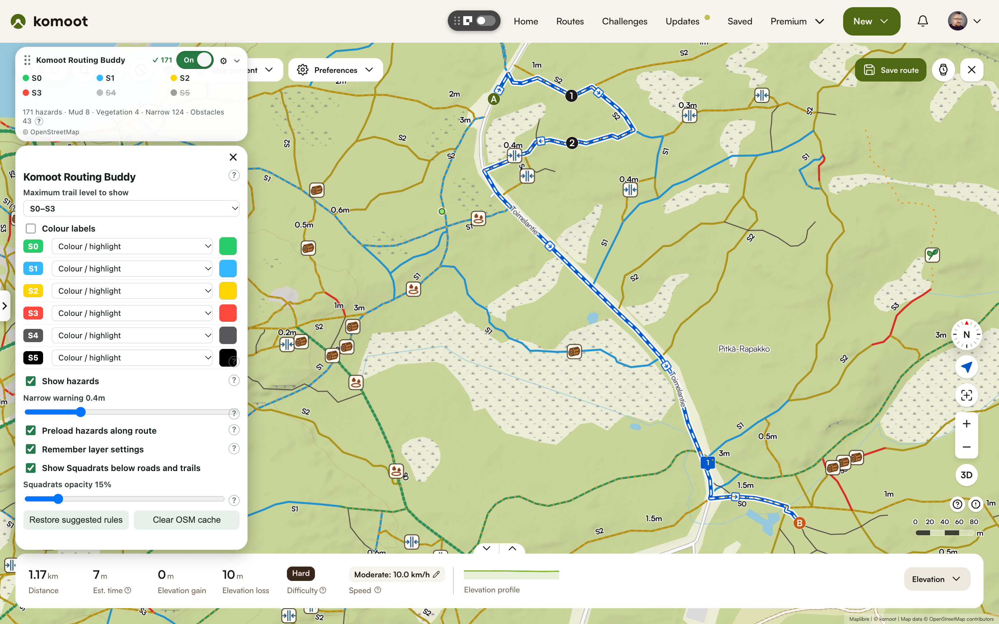
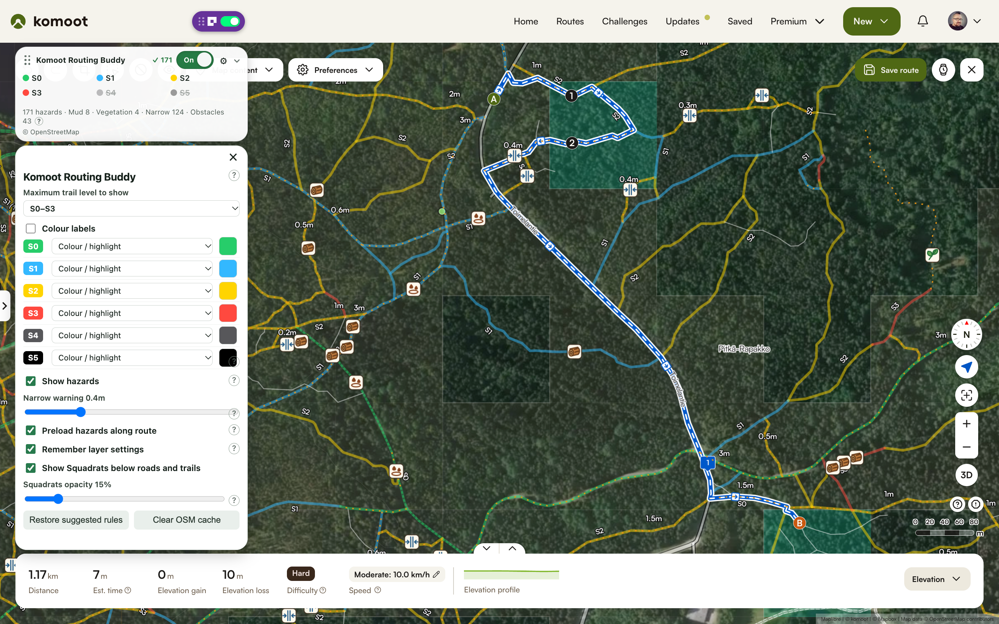
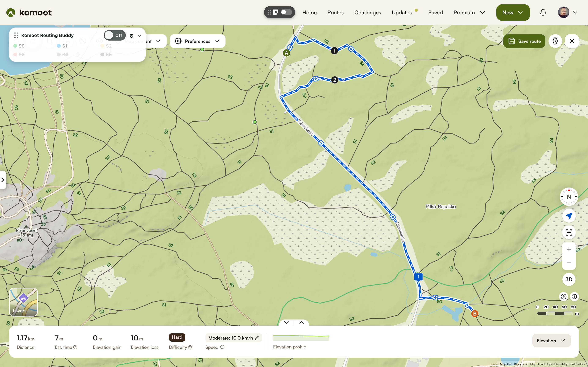

# Komoot Routing Buddy

Make mountain bike trails easier to read on Komoot. Colour S0–S5 trails, show mapped hazards and check the trails along your planned route. Analyse your ride and add named route POIs only after your approval.

Map shortcuts: **Space** toggles a temporary satellite inspection view with a 1 px route and trail highlighting, sport overlays, heatmaps and Squadrats hidden. Press it again to restore the previous view. **1–5** select base maps, **Q–T** select sport maps in displayed order. See Settings → Keyboard shortcuts or [the shortcut reference](docs/KEYBOARD-SHORTCUTS.md).

## What it does

- Choose trail colours and the difficulty levels to highlight, with or without Komoot’s MTB layer.
- Show mapped mud, overgrown sections, fallen trees, obstacles and trail widths.
- Check trails against your maximum difficulty and minimum width; click a warning to jump to it on the map.
- Remember your map layers, sidebar and floating panel position.
- Adjust Squadrats opacity and place its squares below roads and trails. Requires the separate Squadrats extension.

Works on Komoot’s planner, route editing and full-screen map pages. Desktop Chrome/Brave and Firefox packages share the same features. Mobile has not been validated.

## Route analysis

Click **Analyse route** on the floater, even while collapsed, to start the Komoot ride summary and trail checks together. The summary shows route character, climbing concentrations and steep climbs as soon as it is ready. Adjust the minimum Gravel, Trails and Technical distances, maximum gap, ascent, gradient and climb-length thresholds as needed. Surface, way-type and elevation data come from Komoot. Missing native metadata stays unknown; the ride summary does not query OSM. Native S grades are used first; the automatic trail check reuses the existing conservative OSM matching to fill missing MTB grades. Komoot surfaces and way types are never replaced by OSM.

Gravel qualifies after at least 1.5 km of actual gravel/dirt riding. Trails (singletrack or S0 paths) require 500 m; Technical (S1–S5) requires 250 m. Gaps up to 150 m join stretches without counting towards the minimum; each POI marks the first point of that riding category.

Warnings appear beside riding sections in the distance-ordered **Along the route** list. Difficulty, width and mapped obstacles have distinct icons and labels. Hover or keyboard focus highlights a section without moving the map; clicking zooms to it. Ride data and trail checks have separate progress indicators. Check settings and OSM refresh live under **Check settings & data**. Missing data remains unknown. Closing the panel cancels an active check; route changes invalidate its results. Warnings are separate from POI suggestions.

**Preview route POIs** previews `Gravel`, `Trails`, `Technical`, `Hills`, `Steep climb` and `Halfway` suggestions. Use each card’s magnifier to zoom to and temporarily highlight its section. Use the individual checkboxes to select the points you want, then click **Add approved POIs**. Proposed POIs remain available in their collapsible section. Matching points already on the route stay zoomable and are excluded from approval. Names stay under 16 characters; distance and climbing details appear in the preview. Points use exact positions along the route unless an ordinary waypoint lies within 100 m both geographically and along the route; in that case its position is kept and it receives the generated name and icon. Existing custom POIs are protected. Route edits clear generated customizations while retaining the waypoints and restoring original names. This applies to points created with 1.8.0 ownership metadata; older generated points need manual cleanup. Nearby Hills and Steep climb starts share the more specific climb POI while both findings remain in the analysis. With complete elevation, the overview can show where 95% of climbing is behind you. The extension checks geometry and existing POIs, avoids duplicate additions and restores the original route if insertion fails. Close the dialog to cancel an insertion. Save the route using Komoot when ready; the extension does not save automatically. Komoot and supported devices handle synchronization.

See [feature behavior and validation](docs/RIDE-OVERVIEW.md).

## Install or update

Install Chrome/Brave from the [Chrome Web Store](https://chromewebstore.google.com/detail/ddndlhfekbkhjbalkjojocghcmkndakh) for automatic updates. [GitHub Releases](https://github.com/redfellow/komoot-routing-buddy/releases) also provide manual Chrome and unsigned Firefox packages while Firefox Store availability is pending. Packages include Finland data and are about 150 MB each.

### Chrome / Brave

1. Download the `chrome--` ZIP and extract it to a folder you will keep.
2. Open `chrome://extensions` or `brave://extensions` and enable **Developer mode**.
3. Choose **Load unpacked** and select the extracted folder.
4. Wait for the **Local Finland data** tab to finish importing. It closes automatically.
5. Open a Komoot map. Expand the floater to change settings directly.

To update, replace the files in the same folder with the new Chrome package, then click **Reload** on the extension’s card. Your preferences and local data remain in the browser.

### Firefox

For a permanent installation, use the signed Firefox `.xpi` when provided. The `firefox--` ZIP is an unsigned development package: extract it, open `about:debugging#/runtime/this-firefox`, choose **Load Temporary Add-on**, and select its `manifest.json`. Temporary installations end when Firefox closes. See [Mozilla’s installation guidance](https://extensionworkshop.com/documentation/publish/install-self-distributed/).

## Check trails

Trail checks start automatically with **Analyse route**. Open **Check settings & data** to adjust your limits. Defaults are **S1**, **0.4m** minimum width and hazards disallowed. These choices are separate from map colours.

The checker assesses MTB-rated, unpaved trails. Roads, streets, cycleways and paved paths are excluded. Missing ratings, widths or surface information are reported where relevant; uncertain matches are not checked. Click a warning to centre the map on it. **Allow hazards** skips mud, vegetation and obstacles, but still checks difficulty and width.

If online data is needed, progress shows cached and downloaded areas. Temporary failures retry automatically; **Cancel** stops the check and **Retry** keeps completed areas. Editing the route clears its old results.

## Finland data and updates

Finland data is bundled and imported automatically, so covered map areas and trail checks normally need no online OSM queries. Outside coverage, the extension uses the Overpass API. These public servers can be slow or temporarily unavailable.

Open **Local Finland data** in settings to see the data date or update it. Weekly updates are on by default. A country update downloads roughly 770 MB and takes several minutes; allow several GB of free disk space. Keep its background tab open. You can pause and resume, and your previous data stays usable until the update succeeds.

**Update current route from OSM** fetches fresh data just around that route. Successful results are kept for seven days. **Clear OSM cache** clears online data and route refreshes, but keeps the Finland snapshot.

## Data and privacy

Trail conditions come from OpenStreetMap and may be missing or outdated; this is not live reporting or a guarantee of suitability. Data is [© OpenStreetMap contributors, ODbL](https://www.openstreetmap.org/copyright).

Country data and route matching stay in your browser. Preferences use browser sync storage: when Chrome Sync is enabled, Google synchronizes trail colours, rules, map options and trail-check preferences across your signed-in browsers. There is no analytics or upload to a project-operated server.

**Show hazards is on by default.** Outside local data coverage, viewing the map or checking trails sends map or route-area bounds to Overpass providers (Private.coffee, VK Maps and overpass-api.de), along with normal network information such as your IP address. Explicit route refresh also sends route-area bounds. Geofabrik receives public Finland download requests, not route geometry. Weekly country updates are on by default and download roughly 770 MB. You can turn off **Show hazards** and automatic country updates separately.

Read the [privacy policy](PRIVACY.md) before installing. Komoot Routing Buddy's use of user data complies with the Chrome Web Store User Data Policy, including the Limited Use requirements. This is an independent project, not affiliated with or endorsed by Komoot.

## Preview

## Contributing

See [developer notes](READMORE.md), the [release guide](docs/RELEASING.md) and [local OSM guide](docs/LOCAL-OSM.md).

### Quick guide

On the first supported Komoot map after installation, a three-step guide explains trail colours, Analyse route and approved route POIs. It also appears once for existing installations when upgrading to 1.7.0. Skip or finish it to keep it dismissed across reloads and updates. Replay it through Settings → Show quick guide; clearing settings or country data is unnecessary.

### Road numbers

Settings → Emphasize road numbers makes available road references easier to read beside road names on Komoot's vector map. It is on by default, uses compact road-class shields and respects native label collisions. Availability depends on the map's native data; it does not change route analysis or make extra data requests.

The maximum trail level controls highlighting, not path visibility. Higher grades retain Komoot’s native paths and labels, including in MTB mode. Hazard crumbs follow the highlighting limit; hazard warning icons remain independent.

The floater starts collapsed. Expand it to edit settings directly; there is no separate Settings button. Road-number emphasis defaults on. Squadrats controls appear when its layers are detected on the active map.
